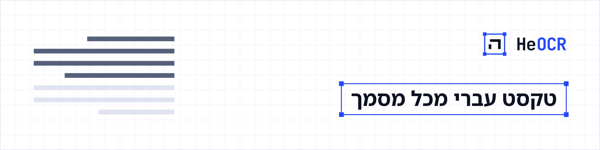
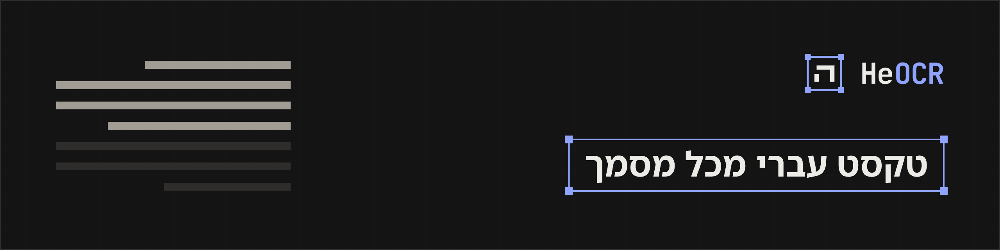

<!-- The Hugging Face organisation card: the README.md of the Space HeOCR/README. -->

  
  

‏HeOCR הוא פרויקט פתוח להוצאת טקסט עברי מכל מסמך: קובצי PDF ואופיס, דפי אינטרנט, סריקות וצילומים. הקוד, המודלים והנתונים פתוחים.

‏**המודלים**
- ‏[heocr-modern-v1-tesseract-heb](https://huggingface.co/HeOCR/heocr-modern-v1-tesseract-heb): מודל Tesseract לדפוס עברי מודרני.
- ‏[heocr-oldprint-v1-tesseract-heb](https://huggingface.co/HeOCR/heocr-oldprint-v1-tesseract-heb): מודל Tesseract לדפוס עברי ישן.

‏כל המודלים ב-Apache-2.0. ביצועים מדווחים רק על סטים נסתרים.

‏**האתר:** [heocr.org](https://heocr.org) · **הקוד:** [GitHub](https://github.com/HeOCR) · **פרסומים:** [Zenodo](https://zenodo.org/communities/heocr) · **חבילת פייתון:** `pip install heocr`

---

HeOCR is an open project for getting Hebrew text out of any document: PDF and Office files, web pages, scans and photos. The code, the models and the data are open.

**Models**
- [heocr-modern-v1-tesseract-heb](https://huggingface.co/HeOCR/heocr-modern-v1-tesseract-heb): a Tesseract model for modern Hebrew print.
- [heocr-oldprint-v1-tesseract-heb](https://huggingface.co/HeOCR/heocr-oldprint-v1-tesseract-heb): a Tesseract model for old Hebrew print.

All models are Apache-2.0. Performance is reported only on held-out sets.

**Website:** [heocr.org/en](https://heocr.org/en/) · **Code:** [GitHub](https://github.com/HeOCR) · **Publications:** [Zenodo](https://zenodo.org/communities/heocr) · **Python package:** `pip install heocr`
