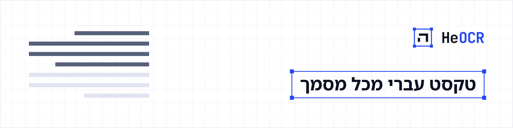

<!-- For HeOCR/.github at profile/README.md. The Hebrew is approved wording only: the tagline, the maintainers' one-liners (tools/repos.json) and the lines the owner approved on 2026-11-20. -->

  <picture>
    <source media="(prefers-color-scheme: dark)" srcset="https://raw.githubusercontent.com/HeOCR/heocr.github.io/main/design/asset-pack/banners/master/banner-he-dark.png">
    <source media="(prefers-color-scheme: light)" srcset="https://raw.githubusercontent.com/HeOCR/heocr.github.io/main/design/asset-pack/banners/master/banner-he-light.png">
    
  </picture>

‏HeOCR הוא פרויקט פתוח להוצאת טקסט עברי מכל מסמך: קובצי PDF ואופיס, דפי אינטרנט, סריקות וצילומים. הקוד, המודלים והנתונים פתוחים, והכלים רצים על המחשב או הטלפון שלכם.

‏**האתר:** [heocr.org](https://heocr.org) · **מודלים:** [Hugging Face](https://huggingface.co/HeOCR) · **פרסומים:** [Zenodo](https://zenodo.org/communities/heocr)

‏**כלים**
- ‏[heocr](https://github.com/HeOCR/heocr): חבילת פייתון וכלי שורת פקודה: טקסט עברי מקובצי PDF, אופיס, דפי אינטרנט, סריקות וצילומים.
- ‏[heocr-desktop](https://github.com/HeOCR/heocr-desktop): האפליקציות של HeOCR למק, לווינדוס ולאנדרואיד: טקסט עברי ממסמכים, בלי אינטרנט.

‏**מודלים ונתונים**
- ‏[heocr-engine](https://github.com/HeOCR/heocr-engine): המודלים: אימון ואריזה של מודלי זיהוי טקסט עברי.
- ‏[htext](https://github.com/HeOCR/htext): טקסט עברי בנחלת הכלל וברישיון פתוח, לאימון OCR בעברית.
- ‏[hocrsyngen](https://github.com/HeOCR/hocrsyngen): מחולל נתונים סינתטיים לאימון זיהוי טקסט עברי: שורות ועמודים.
- ‏[hdocsyngen](https://github.com/HeOCR/hdocsyngen): מחולל מסמכים סינתטיים בעברית: קובצי Office ו-PDF, עם מבנה מדויק.

‏**בדיקה ותשתית**
- ‏[heocr-review](https://github.com/HeOCR/heocr-review): בודקים ומתקנים טקסט עברי מול סריקות של דפים, שורה אחר שורה.
- ‏[heocr-compute](https://github.com/HeOCR/heocr-compute): מריץ את עבודות האימון של HeOCR על מכונות שכורות: מידע פתוח בלבד, בתוך תקציב.

‏**רוצים לעזור?** פתחו issue או pull request באחד המאגרים.

---

HeOCR is an open project for getting Hebrew text out of any document: PDF and Office files, web pages, scans and photos. The code, the models and the data are open, and the tools run on your own computer or phone.

**Website:** [heocr.org/en](https://heocr.org/en/) · **Models:** [Hugging Face](https://huggingface.co/HeOCR) · **Publications:** [Zenodo](https://zenodo.org/communities/heocr)

**Tools**
- [heocr](https://github.com/HeOCR/heocr): Python package and CLI: Hebrew text out of PDFs, Office files, web pages, scans and photos.
- [heocr-desktop](https://github.com/HeOCR/heocr-desktop): HeOCR's apps for Mac, Windows and Android: Hebrew text out of documents, fully offline.

**Models and data**
- [heocr-engine](https://github.com/HeOCR/heocr-engine): The models: training and packaging Hebrew OCR models.
- [htext](https://github.com/HeOCR/htext): Public-domain and openly licensed Hebrew text, for training Hebrew OCR.
- [hocrsyngen](https://github.com/HeOCR/hocrsyngen): A generator of synthetic Hebrew OCR training data: lines and pages.
- [hdocsyngen](https://github.com/HeOCR/hdocsyngen): A generator of synthetic Hebrew documents: Office files and PDFs, with exact structure.

**Review and infrastructure**
- [heocr-review](https://github.com/HeOCR/heocr-review): Check and correct Hebrew text against page scans, line by line.
- [heocr-compute](https://github.com/HeOCR/heocr-compute): Runs HeOCR's training jobs on rented machines: open data only, within a budget.

**Want to help?** Open an issue or a pull request in any of the repositories.
